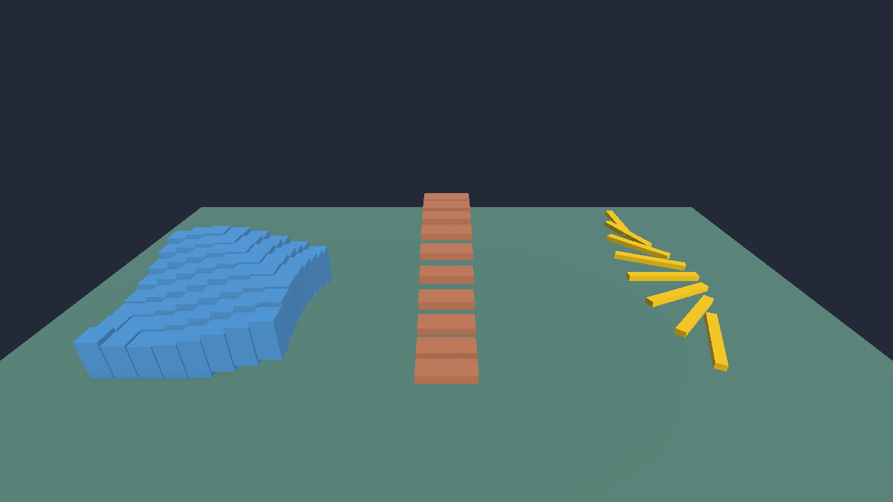

# RollaBallAfter

Roll a Ball チュートリアル（GP08〜GP10）の発展内容と、**GP11 補助教材（複数オブジェクトのリサージュ軌道・位相ずらしグループアニメーション）** をまとめたリポジトリです。

## 解説マニュアル

- **[WaveGroupAnimator 利用マニュアル（GP11 補助教材）](./docs/WaveGroupAnimator_Manual.md)**
  - 複数オブジェクトの自動配置（`Grid` / `Line` / `Circle`）と位相ずらし（`Phase Shift`）
  - Inspector エディタ拡張によるプリセット（波打つ床・動く階段・連鎖回転ブレード・3D螺旋ウェーブ）とリアルタイム簡易ビューア
  - Unity スクリーンショット付きの利用例とパラメータ設定一覧

## 主なスクリプト

- [`Assets/Scripts/WaveAnim.cs`](./Assets/Scripts/WaveAnim.cs) — 単体オブジェクト用リサージュ軌道アニメーション
- [`Assets/Scripts/WaveGroupAnimator.cs`](./Assets/Scripts/WaveGroupAnimator.cs) — 複数オブジェクト配置・グループ化・連鎖アニメーション
- [`Assets/Editor/WaveGroupAnimatorEditor.cs`](./Assets/Editor/WaveGroupAnimatorEditor.cs) — Inspector 簡易ビューア＆プリセット機能
- [`Assets/Editor/GP11SampleBuilder.cs`](./Assets/Editor/GP11SampleBuilder.cs) — サンプルシーン生成＆マニュアル用スクリーンショット撮影ツール
