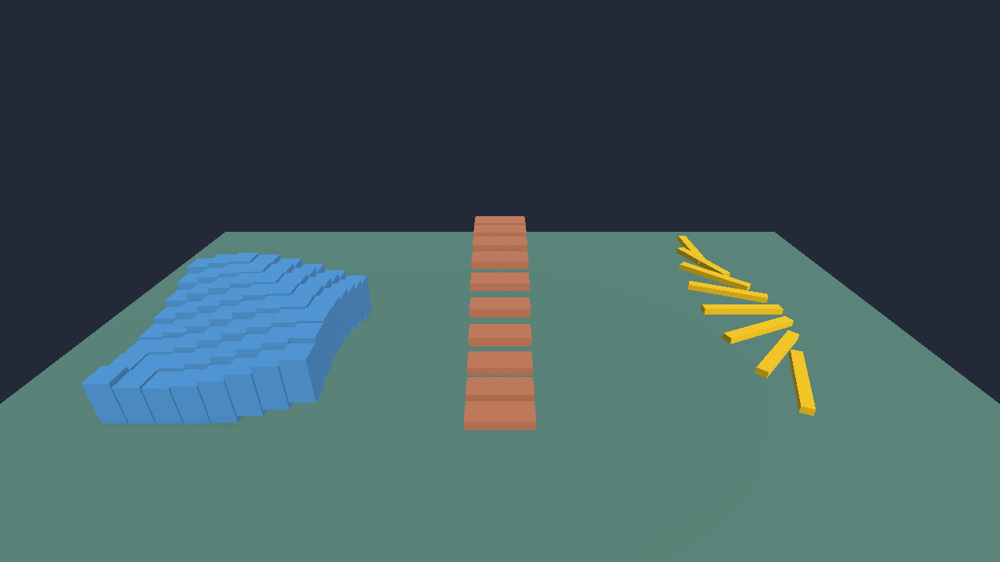
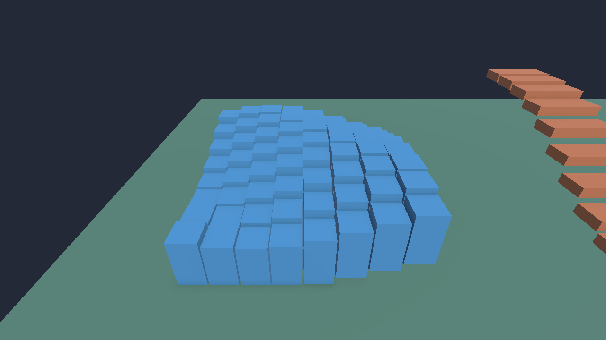
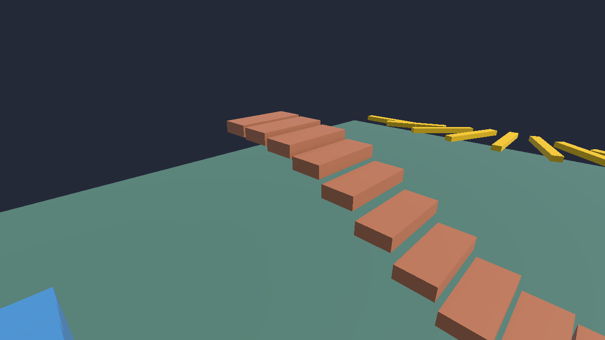
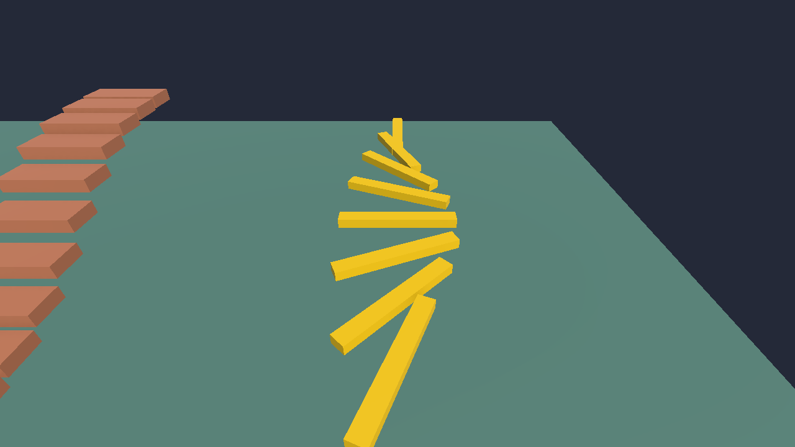
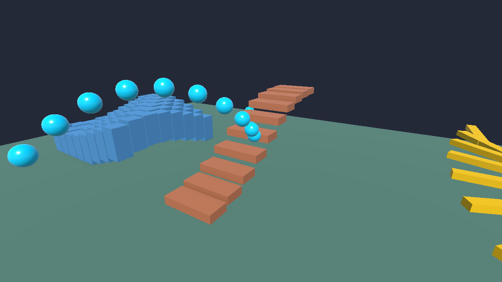

# WaveGroupAnimator 利用マニュアル（GP11 補助教材）

**WaveGroupAnimator** は、Unity のスクリプトによるリサージュ軌道・サイン波アニメーションを **複数オブジェクトの自動配置と位相ずらし（Phase Shift）** に対応させた補助教材用コンポーネント＆エディタ拡張です。

単体オブジェクト用の [WaveAnim.cs](../Assets/Scripts/WaveAnim.cs) では扱いづらかった「柱を敷き詰めて波打つ床」「階段状に配置した動くステップ」「連鎖して回転するブレード」などのギミックを、Inspector 上のボタンとリアルタイム簡易ビューアを使って直感的に作成できます。

*サンプルシーン（`Assets/Scenes/GP11_WaveSample.unity`）の全体像*

---

## 1. ファイル構成

| ファイル | 役割 |
| :--- | :--- |
| [WaveAnim.cs](../Assets/Scripts/WaveAnim.cs) | 単体オブジェクト用のリサージュ軌道アニメーション（授業ベース） |
| [WaveGroupAnimator.cs](../Assets/Scripts/WaveGroupAnimator.cs) | 複数オブジェクトの自動配置・グループ化・位相ずらしアニメーション |
| [WaveGroupAnimatorEditor.cs](../Assets/Editor/WaveGroupAnimatorEditor.cs) | Inspector 拡張（プリセット・生成ボタン・簡易ビューア・SceneView ギズモ） |
| [GP11_WaveSample.unity](../Assets/Scenes/GP11_WaveSample.unity) | 波打つ床・動く階段・連鎖回転ブレードを配置したサンプルシーン |

---

## 2. クイックスタート（3ステップ）

1. Hierarchy で空の GameObject を作成します（例：`WaveFloor`）。
2. Inspector の **Add Component** から `WaveGroupAnimator` を追加します。
3. Inspector 上部の **Quick Teaching Presets** から作りたいパターン（例：`Wave Floor (Grid)`）をクリックします。
   - 子オブジェクトが自動生成され、Play ボタンを押すだけで動作します。

> **Tip:** 既存のオブジェクトや自作 Prefab を使いたい場合は、`targetPrefab` にプレハブを指定して **Generate / Rebuild** を押すか、子オブジェクトとして手動配置した後に **Collect Children** を押してグループ化できます。

---

## 3. エディタ拡張の機能

### 3.1 Quick Teaching Presets & Group Object Management
- **Quick Teaching Presets**: 授業でよく使う 4 パターン（`Wave Floor` / `Moving Stairs` / `Spinning Blades` / `Helix Wave`）をワンクリックで設定・生成します。
- **Generate / Rebuild**: 現在の `LayoutMode`（`Grid` / `Line` / `Circle`）や `countX` / `countZ` / `spacing` に基づいて子オブジェクトを再生成します。
- **Collect Children**: シーン上で手動配置した子オブジェクトをグループメンバーとして登録します。
- **Clear**: 生成した子オブジェクトをすべて削除します。

### 3.2 Phase & Trajectory Mini Viewer（簡易ビューア）
Inspector 下部に、各メンバーの位置・位相ズレ・回転方向をリアルタイムでプレビューできる簡易ビューアを搭載しています。
- **Auto Play**: エディタの Play モードに入らなくても、ビューア上で波や回転の動きを確認できます。
- **Live Scene Preview**: ON にすると、実際の Scene ビュー上のオブジェクトもプレビュー時間に合わせて動かして確認できます。
- **3D 視点回転**: プレビュー領域内で左マウスドラッグすると、視点を自由に回転できます。
- **Preview Time スライダー / Reset t=0**: 任意の時刻での波の形や初期位置（`t=0`）を細かく確認できます。

---

## 4. 利用例

### 利用例 1：柱を敷き詰めて波打つ床（Wave Floor）

格子状（`Grid`）に柱を敷き詰め、X・Z 方向のインデックスごとに位相を少しずつずらすことで、床全体がうねるような波を作ります。

| 主な設定項目 | 値 |
| :--- | :--- |
| `Layout Mode` | `Grid` |
| `Count X` / `Count Z` | `8` / `8` |
| `Spacing` | `(1.05, 0, 1.05)` |
| `Child Scale` | `(1, 2, 1)` |
| `Speed` | `0.5` |
| `Phase Step X / Z (Deg)` | `25` / `25` |
| `Apply Position` | ON / `Pos Amplitude`: `(0, 0.8, 0)` |

---

### 利用例 2：階段状に配置して波打つステップ（Moving Stairs）

直線配置（`Line`）で `Spacing` の Y と Z に値を入れると、階段状の段差を保ったまま各段が順番に上下するギミックになります。

| 主な設定項目 | 値 |
| :--- | :--- |
| `Layout Mode` | `Line` |
| `Count X` | `10` |
| `Spacing` | `(0, 0.35, 1.1)` |
| `Child Scale` | `(2.5, 0.4, 1)` |
| `Speed` | `0.5` |
| `Phase Step X (Deg)` | `36` |
| `Apply Position` | ON / `Pos Amplitude`: `(0, 0.5, 0)` |

---

### 利用例 3：連鎖して回転するブレード（Spinning Blades）

`Apply Position` を OFF、`Apply Rotation` と `Continuous Spin` を ON にし、`Phase Step X` で初期角度をずらすことで、プロペラや風車のように連鎖して回転する障害物を作れます。

| 主な設定項目 | 値 |
| :--- | :--- |
| `Layout Mode` | `Line` |
| `Count X` | `8` |
| `Spacing` | `(0, 0, 1.5)` |
| `Child Scale` | `(3.2, 0.25, 0.4)` |
| `Speed` | `1.0` |
| `Phase Step X (Deg)` | `22.5` |
| `Apply Rotation` | ON / `Continuous Spin`: ON |
| `Spin Speed Deg Per Sec` | `(0, 90, 0)` |

---

### 利用例 4：3D 螺旋ウェーブ（Helix Wave）

X 軸と Y 軸の両方に振幅を設定し、`Pos Axis Phase Deg` を `(0, 90, 0)`（位相差 90°）にすることで各要素が円運動を行い、さらに `Phase Step X` を加えることで 3D の螺旋（DNA らせん状）の動きになります。

| 主な設定項目 | 値 |
| :--- | :--- |
| `Layout Mode` | `Line` |
| `Count X` | `14` |
| `Spacing` | `(0, 0, 0.8)` |
| `Primitive Type` | `Sphere`（`Child Scale`: `0.6`） |
| `Speed` | `0.6` |
| `Phase Step X (Deg)` | `25` |
| `Pos Amplitude` | `(1.5, 1.5, 0)` |
| `Pos Axis Phase Deg` | `(0, 90, 0)` |

---

## 5. Roll a Ball 改造への応用ヒント

- **すり抜け防止（CCD）**: `Add Kinematic Rigidbody` を ON（デフォルト）にしておくと、生成された子オブジェクトに `Rigidbody (isKinematic = true, CollisionDetectionMode.ContinuousDynamic)` が自動付与されるため、動く床や回転ブレードにプレイヤーが乗ったり衝突したりしてもすり抜けにくくなります。
- **リスタート障害物との連携**: `Target Prefab` に `Restarter`（または `RestartOnPlayerCollision`）や危険色のマテリアルを設定したプレハブを指定して `Generate / Rebuild` すれば、連鎖するトラップを簡単に量産できます。
